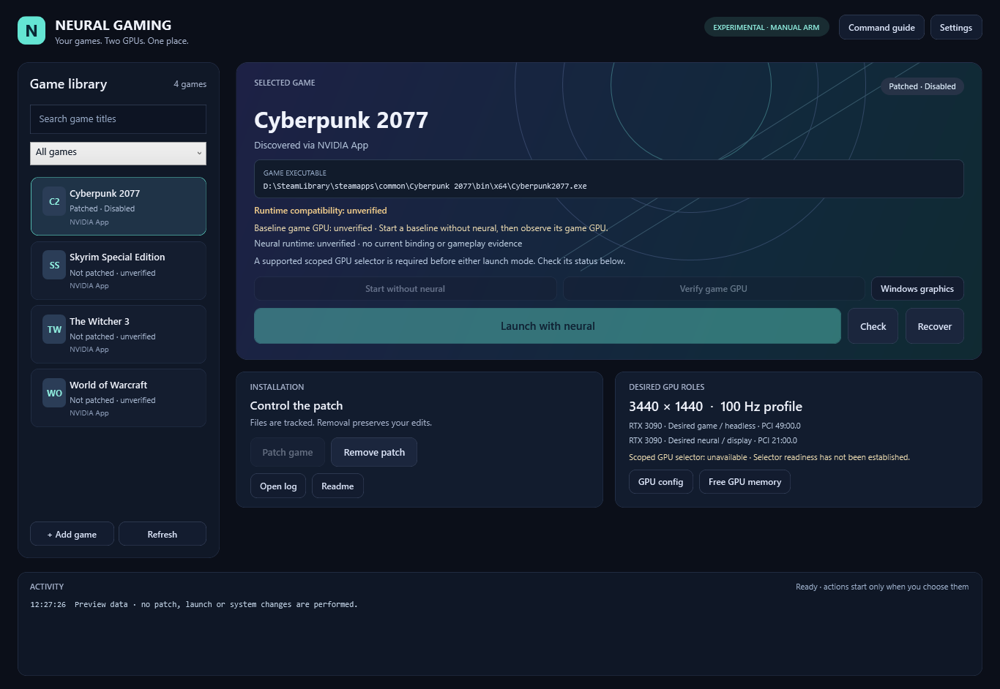

# MGPU Ampere Lab

**Definitely experimental.** I am experimenting with DLSS 5 neural rendering
through MGPU Bridge in Cyberpunk 2077 using **two RTX 3090s**:

- **Headless GPU:** renders the game.
- **Display-connected GPU:** handles the neural rendering and display output.

This project adds a **launcher and tutorial** for that setup. My launcher selects
the physical game GPU even when both cards are the same model, manages the game
patch and session cleanup, and provides a GUI for configuring and running the
experiment. The neural rendering itself is provided by
[MGPU Bridge / Neural-coprocessor](https://github.com/maohgad-web/Neural-coprocessor).

This is my research proof of concept, not a validated stable setup or official
RTX 3090 DLSS 5 support. Crashes, black screens, driver resets and forced reboots
occurred during testing. I suspect excessive power draw or GPU load, but the
cause remains unresolved.

## Quick setup and use with the launcher

After the one-time downloads and build, I use the launcher to configure GPU
roles, patch the game, check the setup and start sessions. It runs the management
scripts for you, including restoring the managed injector state after normal
game exit. GPU configuration can be saved from the GUI instead of editing JSON.

### One-time setup

1. Use Windows 10 or newer with two GPUs and a working NVIDIA driver. Connect
   the display to the **neural GPU** and leave the **game render GPU** headless.
   Back up Cyberpunk 2077 and your saves, close the game, and stop other GPU
   workloads. Review the [requirements](#1-understand-the-requirements-and-limits)
   and [dependency credits](THIRD_PARTY.md).
2. Clone the repository and run these commands in PowerShell as a normal user.
   The launcher does **not** download these dependencies or build the selector:

   ```powershell
   git clone https://github.com/AlexIn-Tech/mgpu-ampere-lab.git
   Set-Location .\mgpu-ampere-lab
   Remove-Item Env:NEURAL_GAMING_ROOT -ErrorAction SilentlyContinue
   & .\scripts\Get-NeuralPackages.ps1
   & .\scripts\Install-NeuralPinningToolchain.ps1
   & .\scripts\Build-NeuralPinning.ps1
   ```

   Run the [fixture checks](#5-run-the-fixture-checks-before-patching-a-game)
   before patching a game; the complete suite requires PowerShell 7 as well as
   Windows PowerShell 5.1. The launcher itself uses Windows PowerShell 5.1.
3. Double-click **`Launch-NeuralGaming.cmd`**. Open **Settings**, choose the
   headless card as the game GPU and the display-connected card as the neural
   GPU, then click **Save profile**. Use the physical GPU identifiers to tell
   identical cards apart. Display values are metadata; apply the actual
   resolution and refresh rate in Windows and the game separately.
4. Select Cyberpunk 2077 in the library. If it is missing, use **Add game** and
   select `Cyberpunk2077.exe` in the game's `bin\x64` directory. Click
   **Patch game**, review the acknowledgment, then click **Check**. Resolve any
   reported issues before launching. Patching stages the managed files disabled;
   the launcher enables them for a neural session.

### Launch and use

1. Keep game frame generation off for initial testing and start with a modest
   resolution. If reproducing my Afterburner experiment, apply **75% power limit**
   and **77 °C temperature limit** to **both cards** manually. These settings
   accompanied a successful session; they are not a proven stability fix.
2. Click **Launch with neural**. A baseline run is optional. Wait for the
   launcher's fresh runtime status to confirm the game uses the headless card
   and the bridge uses the display card; **Open log** provides more detail.
   Close the game if the roles do not match.
3. Press **Ctrl+Alt+F10** in the game to activate neural rendering after binding
   matches. Use **Home** for ReShade and **Ctrl+Alt+F7** to compare output.
   Activation is manual; the launcher starts with `AutoArm=0`. Check actual
   streaming/output rather than relying only on GPU utilization.
4. Close the game normally when finished; the managed session disables the
   injectors and restores the previous AutoArm setting. After an interrupted
   session, close the game and click **Recover**. Use **Remove patch** to uninstall
   the unchanged managed files. Restore Afterburner settings separately.

This remains an experimental POC. For detailed setup, diagnostics and rollback,
see the [full tutorial](#tutorial) below.

## Launcher preview



Captured from the launcher's built-in preview mode with example games and GPU
roles. The displayed compatibility and runtime states are preview data; no game
was launched and no personal configuration was used for this capture.

## What I observed

| Item | Reported configuration / result |
|---|---|
| GPUs | Two RTX 3090s, 24 GB each; VRAM is not pooled |
| Game | Cyberpunk 2077, DirectX 12; tested executable version `3.0.5294808` |
| Bridge / ReShade / model | MGPU 0.3.1 / ReShade 6.8.0 full add-on / community-modified 310.8.SF-v2 |
| Display | One display on the neural card; headless card renders the game; 3440×1440 / 100 Hz metadata |
| Neural output | Earlier preserved runtime logs confirmed distinct game/bridge adapters and neural output |
| Latest session | I got it working after applying MSI Afterburner limits to both cards: **75% power, 77 °C temperature limit** |
| Stability | I saw high utilization on both cards and suspect a later crash, though I could not confirm it. Earlier freezes also occurred with neural disabled and ordinary game launches |
| Measurements | No controlled FPS, latency, image-quality or long-duration stability comparison |

These limits accompanied a successful session. They are **not a demonstrated
crash fix or recommended universal preset**. The temperature limit is a control
setting, not a measurement of the GPU, hotspot or memory-junction temperature.
Driver version and duration of the latest successful session were not captured
in this public report. Keep those details in any reproduction report.

## What I did differently

I retained upstream's single-display `DcompOverlay=1` arrangement. The display
card performs neural rendering and presents the result; the headless card renders
Cyberpunk. Two identical cards made model-based Windows graphics preferences an
insufficient physical-card identifier in my setup.

My launcher resolves the selected GPU UUID to its **current adapter LUID** and
uses Microsoft Detours to load a selector before the game's entry point. The
selector redirects only the supported **main executable import** of
`sl.interposer.dll!D3D12CreateDevice`. It passes the headless adapter to the
preserved Streamline wrapper. MGPU's separate device import remains independent.
This is a custom experimental hook, not an upstream MGPU feature. Source lives
in [native/](native/) and its manager in [NeuralGaming.Pinning.ps1](powershell/NeuralGaming.Pinning.ps1).

No virtual display driver, SLI configuration or system-wide DirectX hook is
installed. Setting `CUDA_VISIBLE_DEVICES` does not select a DirectX game adapter.
High activity on both cards alone does not establish correct device binding or
live neural output; inspect fresh bridge logs.

## Tutorial

### 1. Understand the requirements and limits

- Windows 10 or newer, x64, and Windows PowerShell 5.1 for WPF. PowerShell 7 is required for
  the complete cross-edition fixture suite; ordinary GUI/gameplay can use 5.1.
- Two suitable GPUs and a working NVIDIA driver with `nvidia-smi` available.
  This report covers two RTX 3090s; other combinations are unverified here.
- Cyberpunk 2077 installed, closed, and backed up. Use an offline experiment.
  Do not use this injected launcher in anti-cheat or competitive games.
- One display attached to the intended **neural** GPU, with the **game render**
  GPU headless, matching the topology checked by this manager.
- Enough cooling, power supply capacity and free GPU memory for both workloads.
  Stop your other GPU workloads yourself before testing.

Review the [third-party dependencies](THIRD_PARTY.md) first. The modified model and other
downloaded binaries run inside or alongside the game and are separate trust
decisions. Do not weaken antivirus or driver protections to force the experiment
to run. Use a normal user shell for setup, building and gameplay.

### 2. Clone and inspect

```powershell
git clone https://github.com/AlexIn-Tech/mgpu-ampere-lab.git
Set-Location .\mgpu-ampere-lab
$labRoot = (Get-Location).Path
# Prevent an old fixture/CLI override from directing state elsewhere:
Remove-Item Env:NEURAL_GAMING_ROOT -ErrorAction SilentlyContinue
Import-Module .\powershell\NeuralGaming.psm1 -Force
```

Keep this folder in a local directory writable only by users you trust. State,
packages, build products, local GPU identities and logs stay in ignored `runtime/`.
Importing the module or opening the GUI does not start a game.

### 3. Record your physical GPU roles

```powershell
Get-NeuralGpus | Format-Table Index,Name,Uuid,PciBusId,DisplayActive
New-Item -ItemType Directory -Path .\runtime -Force | Out-Null
Copy-Item .\config.example.json .\runtime\config.json
notepad .\runtime\config.json
```

Replace the two example UUIDs in the JSON with your own:

```json
{
  "renderUuid": "GPU-YOUR-HEADLESS-CARD-UUID",
  "neuralUuid": "GPU-YOUR-DISPLAY-CARD-UUID",
  "display": { "Width": 3440, "Height": 1440, "RefreshHz": 100 }
}
```

Use distinct physical UUIDs. GPU indices and LUIDs may change, so do not reuse
someone else's values. The display fields are metadata; configure the actual
resolution and refresh rate in Windows/the game yourself. Recheck roles after
moving cables or changing adapters.

### 4. Obtain the pinned dependencies

Read the download scripts and third-party notes, then run explicitly:

```powershell
& .\scripts\Get-NeuralPackages.ps1
& .\scripts\Install-NeuralPinningToolchain.ps1
& .\scripts\Build-NeuralPinning.ps1
```

The first script downloads MGPU 0.3.1, the modified model and ReShade 6.8.0;
checks fixed SHA-256 hashes; and extracts them under `runtime/packages`.
It does not run the ReShade installer. The second provisions pinned portable
LLVM-MinGW and Microsoft Detours sources under `runtime/toolchains`, without
changing PATH or installing a system compiler. Building is a separate step.

Hash mismatches are errors. Existing mismatched cached archives are retained
and refused; failed new partial downloads are cleaned up. Preserve any retained
artifact for investigation. Do not remove verification or substitute a newer
file under the same name.
Matching archive hashes do not establish that a binary is safe. Model support
on Ampere is unofficial. Only obtain Afterburner from [MSI's official page](https://www.msi.com/Landing/afterburner/graphics-cards)
if you choose to reproduce the reported limits; this repository does not install it.

### 5. Run the fixture checks before patching a game

```powershell
& .\tests\Invoke-AllTests.ps1
# Also verify the Windows PowerShell edition, from the same directory:
powershell.exe -NoProfile -ExecutionPolicy Bypass -File .\tests\Invoke-AllTests.ps1
```

Fifteen suites cover provisioning security, bounded import inspection, startup
ownership, file ownership, recovery, adapter mapping, native import
selection, runtime interpretation, process lifecycle, catalog, library, GUI,
workers and cross-edition behavior. Native fixtures enumerate adapters and use
fake device exports; they create no GPU workload and launch no real game.
GUI tests may briefly display fixture windows. These checks do not validate
the game, NVIDIA model or long-term GPU stability.

`ExecutionPolicy Bypass` above applies only to that child shell; it does not
change machine policy. Review the code before running it, and respect any
organizational restrictions on unsigned scripts.

### 6. Back up and stage Cyberpunk while it is closed

Back up your saves and the game directory separately. System Restore is not a
backup of saves or game files. If you want a restore point, create it through
Windows System Protection yourself. No elevated restore-point helper is included
in this public package. Setup and gameplay should run as a normal user.

```powershell
# Replace this example with the real x64 executable, not REDlauncher.exe:
$gameExe = 'D:\Games\Cyberpunk 2077\bin\x64\Cyberpunk2077.exe'
Install-NeuralGame -Name Cyberpunk2077 `
  -Executable $gameExe `
  -PackagePath (Join-Path $labRoot 'runtime\packages\bridge-0.3.1') `
  -ReShadeDll (Join-Path $labRoot 'runtime\packages\reshade-6.8.0\ReShade64.dll') `
  -NeuralDll (Join-Path $labRoot 'runtime\packages\dlssnr-310.8.SF-v2\nvngx_dlssnr.dll')
Get-NeuralGameStatus -Name Cyberpunk2077 | Format-List
Test-NeuralGameSetup -Name Cyberpunk2077 | Format-List
Get-NeuralGamePinning -Name Cyberpunk2077 | Format-List
```

The installer refuses competing DLL/add-on/config files rather than replacing
them. Back up and inspect conflicts; do not delete mods just to bypass the
check. The two managed injector filenames are staged disabled:

```text
dxgi.dll.neural-disabled
nvngx.dll_mgpu_bridge.addon64.neural-disabled
mgpu.ini
gpu1.ini
ReShade2.ini
ReShade.ini
NeuralGamingPreset.ini
mgpu/nvngx_dlssnr.dll
reshade-shaders/Shaders/mgpu_depth_tap.fx
```

Keep the neural DLL in `mgpu/`, **never beside the executable**, to avoid the
game's Streamline loader picking it up on the wrong device. Existing game DLSS
DLLs are not replaced. `ExperimentalReady` means selector checks passed, not
that gameplay is stable. A different executable/import layout can be unsupported;
do not remove the refusal to force a launch.

### 7. Configure the experiment manually

Keep game frame generation **off** for initial validation. Begin at a lower
resolution and record the exact DLSS, ray tracing, Ray Reconstruction and FPS
cap settings. Do not claim this report establishes an optimal preset.

The managed bridge settings include `AutoArm=0`, `Passes=1`, `DcompOverlay=1`
and `NRFrameFilter=0`. The launcher verifies `AutoArm=0` before starting the
process. AutoArm controls stream activation; it does not disable game frame
generation or all model startup probes.

For the reported Afterburner experiment, select each physical RTX 3090 and apply
**75% power limit** and **77 °C temperature limit** to each. Confirm both cards
received the settings. This is optional reproduction of an observation, not
proof the PC is stable. Save your previous settings so you can restore them.

### 8. Launch, check binding, then activate

```powershell
Start-NeuralGame -Name Cyberpunk2077
# The managed command waits for the game session; inspect from a second shell:
Set-Location '<your mgpu-ampere-lab folder>'
Import-Module .\powershell\NeuralGaming.psm1 -Force
Get-NeuralGameRuntime -Name Cyberpunk2077 | Format-List
```

Verify fresh logs show the **game on the headless card** and **bridge on the
display card**. Close the game if the roles mismatch. Press **Ctrl+Alt+F10** to
activate after binding matches. Open ReShade with **Home**; use **Ctrl+Alt+F7**
to compare neural/input/split output. Binding, arming and streaming are separate
states: model loading or startup probes are not sufficient evidence of live output.

Use the manager or supplied PowerShell entry scripts for launch. They supervise
startup in an owned Windows job and cancel only their startup process tree on
failure. Directly running the internal `NeuralPinnedLaunch.exe` bypasses that
supervision and is not the supported tutorial path.

Do not change resolution, DLSS mode or presets while armed; exit and relaunch.
Use short observed sessions while investigating instability. Stop if there is
a black screen, visual corruption or other abnormal behavior. Save the failure
evidence locally rather than repeatedly stress-testing a failing setup.

For optional diagnostics, `Start-NeuralGameBaseline` launches without the two
managed neural injectors **but still uses my experimental selector**. Run
`Confirm-NeuralGameGpu` while playing, then close it. A normal Steam/direct launch
after cleanup is the comparison that also excludes my selector. Baseline
verification is optional and does not gate direct neural launch.

### 9. Use the optional game library

Double-click `Launch-NeuralGaming.cmd`, or run
`& .\scripts\Start-NeuralGamingGui.ps1`. The GUI reads NVIDIA App's local game
catalog; it does not change that cache. Use **Add game** if needed, **Settings**
for GPU roles/display metadata, then **Launch with neural** for a staged game.
New games require acknowledgment and patching; catalog discovery does not prove
compatibility. The current selector targets its supported DirectX 12 import.
The generic library and upstream DX11 support do not make arbitrary titles
compatible with this selector.

The **Free GPU memory** action is a legacy optional LocalAI integration requiring
`C:\AI\LocalAI\LocalAI.psm1` and `Stop-LocalAIAll` on your own machine.
It is not a generic VRAM-cleaning feature. Without that integration, stop your
workloads yourself. No PowerShell profile modification is required.

### 10. Recover or uninstall

Normal managed exit disables the injectors and restores the prior AutoArm value.
If the worker is killed or power is lost, close the game and run:

```powershell
Stop-NeuralGame -Name Cyberpunk2077
Get-NeuralGameStatus -Name Cyberpunk2077 | Format-List
# Optional complete removal after recovery:
Uninstall-NeuralGame -Name Cyberpunk2077
```

Before a normal Steam/direct launch, status should be **Disabled** and the live
managed injector filenames absent. Recovery does not terminate a running game.
Uninstall removes only unchanged owned files; if you edited configurations,
preserve and compare those edits before resolving the reported conflict. Keep
`runtime/` and ownership manifests until rollback is finished. Restore your
Afterburner settings separately.

## Troubleshooting and reporting

- **Launch blocked:** inspect setup/pinning results and paths. Missing toolchain,
  changed build hashes, invalid topology and unsupported imports fail closed.
- **Provisioning rerun refused:** package extraction preserves existing folders;
  inspect and move them aside yourself before a fresh extraction. Cached toolchain
  folders are reused only when every file matches the pinned archive and no extra
  files or reparse points are present. Verification can take time on large archives.
- **Get-FileHash unavailable in Windows PowerShell:** close/reopen the GUI after
  updating; the supplied entry scripts initialize the edition's built-in module
  paths. Do not download a replacement hashing module.
- **Both GPUs busy:** check physical binding and actual output, not utilization alone.
- **Freeze/device removal:** ordinary Cyberpunk sessions also froze during my testing.
  Power, cooling, driver, PCIe/riser and workload remain hypotheses, not diagnoses.
- **Public report:** include driver/game versions, pinned dependency versions,
  topology, exact settings, elapsed time, baseline method and a short relevant log
  excerpt. Replace UUIDs with consistent `GPU-render` / `GPU-neural` labels and
  remove usernames, paths and unrelated process details. Never upload raw dumps,
  runtime directories, configuration or saves without reviewing them.

## License and contribution

My code is MIT licensed; external dependencies retain their own terms. See
[THIRD_PARTY.md](THIRD_PARTY.md). Contributions should include a reproducible
case, appropriate fixture checks and clearly separated observations/hypotheses.
